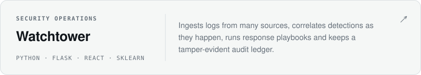
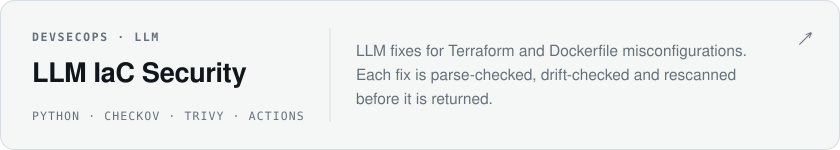
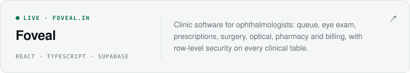

<picture>
  <source media="(prefers-color-scheme: dark)" srcset="assets/chart-dark.svg">
  
</picture>

  <picture>
    <source media="(prefers-color-scheme: dark)" srcset="https://readme-typing-svg.demolab.com?font=Atkinson+Hyperlegible+Mono&size=17&duration=2800&pause=1600&color=8B949E&center=true&vCenter=true&width=620&height=44&lines=I+build+software+where+mistakes+are+expensive.;Security+tooling+that+catches+the+right+thing.;Healthcare+software+clinicians+can+rely+on.">
    
  </picture>

### Hi, I'm Shlok.

I like systems that can show their working: detections with the evidence attached, audit trails
nobody can quietly edit, fixes that are rescanned before anyone trusts them, and test suites that
drive the real interface instead of a mock.

#### Selected work

<a href="https://github.com/Shlok014/watchtower">
  <picture>
    <source media="(prefers-color-scheme: dark)" srcset="assets/card-watchtower-dark.svg">
    
  </picture>
</a>
<a href="https://github.com/Shlok014/llm-iac-security">
  <picture>
    <source media="(prefers-color-scheme: dark)" srcset="assets/card-iac-dark.svg">
    
  </picture>
</a>
<a href="https://foveal.in">
  <picture>
    <source media="(prefers-color-scheme: dark)" srcset="assets/card-foveal-dark.svg">
    
  </picture>
</a>

#### Toolkit

<picture>
  <source media="(prefers-color-scheme: dark)" srcset="https://skillicons.dev/icons?i=python,ts,react,vite,tailwind,postgres,supabase,flask,sklearn,docker,terraform,githubactions,linux&theme=dark&perline=13">
  
</picture>

#### Activity

<picture>
  <source media="(prefers-color-scheme: dark)" srcset="https://raw.githubusercontent.com/Shlok014/Shlok014/output/stats-dark.svg">
  
</picture>

<picture>
  <source media="(prefers-color-scheme: dark)" srcset="https://raw.githubusercontent.com/Shlok014/Shlok014/output/snake-dark.svg">
  
</picture>

The eye chart, cards and stats are drawn by the scripts in this repo. Stats refresh every morning.

